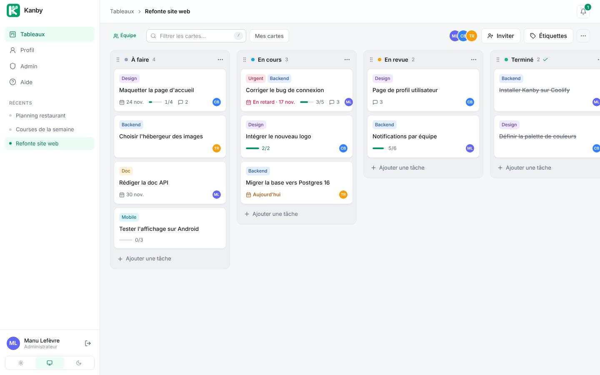
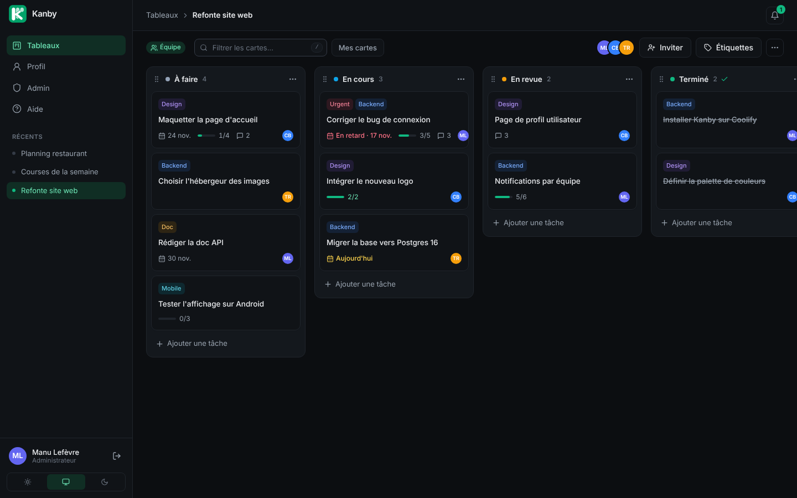
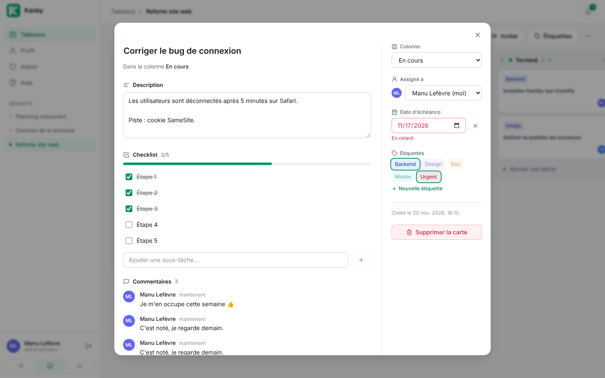
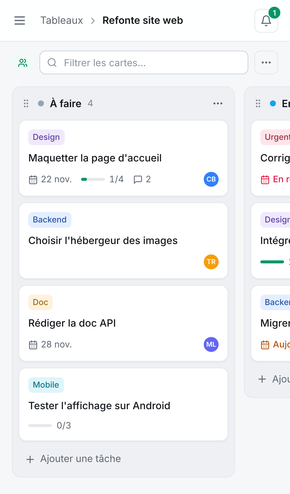

<p align="center">
  
</p>

<h1 align="center">Kanby</h1>

<p align="center">
  Un gestionnaire de tâches <strong>Kanban</strong> simple, moderne et <strong>auto-hébergé</strong>.<br />
  Mode clair / sombre, glisser-déposer fluide, tableaux d'équipe, 100 % responsive.
</p>

<p align="center">
  
  
</p>

---

## Sommaire

- [Fonctionnalités](#fonctionnalités)
- [Installer Kanby sur Coolify](#installer-kanby-sur-coolify) ⭐ recommandé
- [Installer avec Docker Compose](#installer-avec-docker-compose)
- [Mise à jour](#mise-à-jour) · [Sauvegarde](#sauvegarde)
- [Variables d'environnement](#variables-denvironnement)
- [Administration](#administration) · [Kosmy Board](#se-connecter-avec-kosmy-board-optionnel) · [Admin dans Kosmy Board](#admin-dans-kosmy-board) · [Utilisateurs gérés par Kosmy Board](#utilisateurs-gérés-par-kosmy-board)
- [API mobile & intégrations](#api-mobile--intégrations) · [Widget Dashy](#widget-dashy-optionnel)
- [Tests](#tests) · [Développement](#développement-sans-docker) · [Stack](#stack-technique)

---

## Fonctionnalités

- **Tableaux** personnels (privés) ou d'équipe (partagés avec d'autres comptes)
- **Colonnes** : renommer, colorer, réordonner (glisser ou menu), choisir leur
  type *À faire / En cours / Terminé*. Déposer une carte dans *Terminé* la coche
  (et lance des confettis 🎉)
- **Cartes** : titre, description, échéance (en retard / aujourd'hui mis en
  évidence), étiquettes colorées, checklist avec progression, assignation,
  commentaires. Lien direct vers une carte (`/boards/<id>?card=<id>`)
- **Calendrier** : chaque tableau a une vue *Mois* / *Semaine* où l'on crée en
  un clic un Kanban par jour ou par semaine. Il se nomme tout seul
  (« Elisa30 — Mardi 24 novembre 2026 », « Elisa30 — Semaine 48 · 23 → 29 nov.
  2026 »), reprend les colonnes et étiquettes du tableau et partage ses membres.
  Flèches ‹ › pour passer au jour (ou à la semaine) suivant. Un Kanban se
  **déplace** vers un autre jour en le glissant dans le calendrier, ou en
  cliquant sur sa date en haut du Kanban (échange possible si le jour est pris)
- **Reporter des tâches** sur un autre jour : une tâche (bouton *Changer de jour*
  dans la carte) ou toutes les tâches non terminées d'un jour (menu du Kanban).
  En ouvrant le Kanban d'aujourd'hui, Kanby propose de reprendre les tâches
  non terminées de la veille
- **Historique des dates** : transferts de tâches, déplacements de Kanban et
  changements d'échéance (dans le calendrier, le menu d'un Kanban et chaque carte)
- **Glisser-déposer** à la souris, au doigt (appui long) et au clavier
  (Espace pour saisir, flèches, Espace pour déposer)
- **Filtre** des cartes (touche `/`), filtre « Mes cartes »
- **Notifications** dans la langue de chaque destinataire
- **Thème** clair, sombre ou automatique (selon l'appareil)
- **Français / anglais**, sélecteur sur la page de connexion et dans le profil
- **Mobile** : colonnes en défilement horizontal, menu latéral, fenêtres en
  bas d'écran
- **Admin** : utilisateurs (rôles, mot de passe temporaire, désactivation,
  suppression), tous les tableaux en lecture seule, statistiques
- **API complète** par token `kbt_…` — voir [`API.md`](./API.md)

<p align="center">
  
  
</p>

---

## Installer Kanby sur Coolify

[Coolify](https://coolify.io) est un panneau d'auto-hébergement (type Heroku /
Netlify chez soi). Kanby fournit un fichier dédié,
[`docker-compose.coolify.yml`](./docker-compose.coolify.yml), qui laisse
Coolify **générer tous les secrets** (mot de passe de la base, secret des
sessions, mot de passe admin) et **gérer le domaine + HTTPS** : vous n'avez
presque rien à saisir.

### Prérequis

- Un serveur avec Coolify v4 installé et un serveur « localhost » ou distant
  connecté (*Servers*).
- *(Optionnel)* Un nom de domaine, par exemple `kanby.mondomaine.fr`, avec un
  enregistrement DNS **A** qui pointe vers l'IP du serveur Coolify. Sans
  domaine, Coolify fournit une adresse de test automatiquement.

### Étapes

1. **Créer la ressource**
   Dans Coolify : **Projects** → choisissez (ou créez) un projet →
   environnement **production** → **+ New** → **Public Repository**.

2. **Indiquer le dépôt**
   - *Repository URL* : `https://github.com/PetitOursManu/Kanby`
   - *Branch* : `main`
   - *Build Pack* : **Docker Compose**
   - *Docker Compose Location* : **`/docker-compose.coolify.yml`**

   Puis **Continue**. Coolify lit le fichier et affiche deux services : `app`
   (Kanby) et `db` (PostgreSQL).

3. **Choisir le domaine**
   Dans la configuration du service **app**, champ **Domains** : mettez votre
   adresse **avec https**, par exemple `https://kanby.mondomaine.fr`.
   Coolify s'occupe du certificat HTTPS (Let's Encrypt) et transmet le trafic
   au port 3000 du conteneur. Si vous laissez la valeur proposée, Kanby sera
   accessible sur l'adresse générée par Coolify.

4. **Vérifier les variables** (onglet **Environment Variables**)
   Les valeurs `SERVICE_…` sont **créées automatiquement** et conservées entre
   les déploiements — ne les modifiez pas :

   | Variable générée | Rôle |
   |---|---|
   | `SERVICE_URL_APP` | adresse publique de Kanby (sert à `APP_URL`) |
   | `SERVICE_PASSWORD_64_JWT` | secret des sessions |
   | `SERVICE_USER_POSTGRES` / `SERVICE_PASSWORD_POSTGRES` | accès à la base |
   | `SERVICE_PASSWORD_ADMIN` | **mot de passe temporaire du compte admin** |

   Variables que vous pouvez ajuster :

   | Variable | Défaut | Conseil |
   |---|---|---|
   | `DEFAULT_ADMIN_EMAIL` | `admin@kanby.local` | mettez votre email **avant** le 1er déploiement |
   | `ALLOW_REGISTRATION` | `true` | valeur de départ ; ensuite, ouvrez ou fermez les inscriptions depuis **Admin → Réglages**, sans redéployer |
   | `DEFAULT_ADMIN_NAME` | `Administrateur` | |
   | `JWT_EXPIRES_IN` | `2592000` (30 jours) | durée des sessions en secondes |

5. **Déployer**
   Cliquez sur **Deploy**. Le premier build prend quelques minutes. Dans les
   logs du service `app`, vous devez voir :
   ```
   [entrypoint] Applying database migrations...
   [seed] Admin par défaut créé : admin@kanby.local
   [entrypoint] Starting Kanby on :3000
   ```
   Le conteneur passe ensuite à l'état **healthy** (Kanby fournit un
   *healthcheck* sur `/api/health`, qui vérifie aussi la base de données).

6. **Première connexion**
   Ouvrez votre domaine, connectez-vous avec `DEFAULT_ADMIN_EMAIL` et la
   valeur de **`SERVICE_PASSWORD_ADMIN`** (visible dans *Environment
   Variables*). Kanby vous demande aussitôt de choisir votre propre mot de
   passe.

C'est tout 🎉 Créez votre premier tableau, puis invitez votre équipe depuis
**Admin → Créer un utilisateur** (ou laissez les inscriptions ouvertes).

### Mettre à jour sur Coolify

Cliquez sur **Redeploy** : Coolify récupère la dernière version du dépôt,
reconstruit l'image et applique automatiquement les migrations de la base au
démarrage. Les données sont dans le volume `kanby-db` et sont conservées.
Pour des mises à jour automatiques à chaque `git push`, activez
*Auto Deploy* dans **Configuration → Advanced** (dépôt relié par l'app GitHub
de Coolify, ou webhook).

### Sauvegarder sur Coolify

- Le plus simple : dans la ressource, **Terminal** → service `db`, puis
  `pg_dump -U "$POSTGRES_USER" "$POSTGRES_DB" > /tmp/kanby.sql`
  (ou planifiez une sauvegarde S3 si votre version de Coolify le propose).
- Lors de la suppression de la ressource, Coolify demande s'il faut supprimer
  les volumes : répondez **non** si vous voulez garder les données.

### Dépannage Coolify

| Symptôme | Cause probable / solution |
|---|---|
| *No available server* ou 502 | Le conteneur `app` n'est pas *healthy*. Ouvrez les **logs du service `app`** : la dernière ligne `[entrypoint] …` donne la cause. |
| Logs : `PostgreSQL refuse l'identifiant / le mot de passe` | Le volume de la base vient d'un **déploiement précédent** (autres identifiants : PostgreSQL ne les change jamais après la création). Si ce volume ne contient rien d'important : **Stop**, onglet **Persistent Storage** → supprimez le volume de `db`, puis **Deploy**. |
| « Le port 3000 est déjà utilisé » | Pas de conflit possible : ce fichier compose ne publie **aucun port** sur le serveur, chaque conteneur a son propre port 3000. Dans *Domains*, gardez `:3000` (ou aucun port) : ce nombre désigne le port **du conteneur**, pas celui du serveur. Mettre `:3006` envoie le trafic vers un port où Kanby n'écoute pas. |
| Connexion impossible, retour à la page de login | L'adresse utilisée doit être celle du champ *Domains* **en https** (le cookie de session est « Secure »). Après un changement de domaine, faites **Redeploy**. |
| `JWT_SECRET n'est pas défini` | La variable `SERVICE_PASSWORD_64_JWT` a été vidée : supprimez-la puis redéployez pour la régénérer. |
| Mot de passe admin perdu | Si un autre admin existe : **Admin → … → Réinitialiser le mot de passe**. Sinon, changez `DEFAULT_ADMIN_EMAIL` (nouvel admin créé au prochain démarrage). |

<details>
<summary><strong>Variante : build pack « Dockerfile » + base PostgreSQL Coolify</strong></summary>

Si vous préférez gérer la base séparément :

1. **+ New → Database → PostgreSQL** ; une fois démarrée, copiez son
   **Postgres URL (internal)**.
2. **+ New → Public Repository** → `https://github.com/PetitOursManu/Kanby`,
   *Build Pack* **Dockerfile**, *Ports Exposes* `3000`.
3. Variables : `DATABASE_URL` (l'URL interne copiée), `JWT_SECRET`
   (`openssl rand -hex 32`), `APP_URL` (votre domaine en https),
   `DEFAULT_ADMIN_EMAIL`, et éventuellement `ALLOW_REGISTRATION=false`.
   Sans `DEFAULT_ADMIN_PASSWORD`, le mot de passe admin temporaire s'affiche
   dans les logs de déploiement.
4. Domaine, puis **Deploy**.
</details>

---

## Installer avec Docker Compose

Pour un serveur, un NAS ou un VPS sans Coolify.

1. **Récupérez Kanby** :
   ```bash
   git clone https://github.com/PetitOursManu/Kanby.git
   cd Kanby
   cp .env.example .env
   ```
2. **Éditez `.env`** — au minimum :
   - `JWT_SECRET` : collez le résultat de `openssl rand -hex 32` (obligatoire)
   - `POSTGRES_PASSWORD` : un mot de passe pour la base
   - `APP_URL` : l'adresse de Kanby (ex. `https://kanby.mondomaine.fr`)
   - `DEFAULT_ADMIN_EMAIL` : votre email
3. **Lancez** :
   ```bash
   docker compose up -d
   docker compose logs app | grep "Mot de passe"   # mot de passe admin temporaire
   ```
4. Ouvrez `APP_URL` (par défaut <http://localhost:3000>) et connectez-vous.
   Kanby vous demande de changer le mot de passe dès la première connexion.

Un fichier [`docker-compose-test.yml`](./docker-compose-test.yml) permet de
lancer une seconde instance de test sur le port **3002** sans toucher à la
production : `docker compose -f docker-compose-test.yml up -d`.

## Mise à jour

```bash
git pull
docker compose up -d --build
```

Les migrations de base de données s'appliquent automatiquement au démarrage.

## Sauvegarde

```bash
# Sauvegarder
docker compose exec db pg_dump -U kanby kanby > sauvegarde.sql
# Restaurer
cat sauvegarde.sql | docker compose exec -T db psql -U kanby kanby
```

---

## Variables d'environnement

| Variable | Rôle | Défaut |
|---|---|---|
| `JWT_SECRET` | Secret de signature des sessions (32 caractères min.) | **obligatoire** |
| `APP_URL` | URL publique ; `https://` active les cookies sécurisés | `http://localhost:3000` |
| `DATABASE_URL` | Connexion PostgreSQL (construite par les fichiers compose) | — |
| `POSTGRES_USER` / `POSTGRES_PASSWORD` / `POSTGRES_DB` | Base PostgreSQL (compose) | `kanby` |
| `APP_PORT` | Port exposé sur l'hôte (compose) | `3000` |
| `JWT_EXPIRES_IN` | Durée de session en secondes (5 min à 1 an) | `2592000` (30 j) |
| `AUTO_ADMIN_ON_BOOT` | Crée l'admin au démarrage | `true` |
| `DEFAULT_ADMIN_EMAIL` | Email de l'admin créé au démarrage | `admin@kanby.local` |
| `DEFAULT_ADMIN_PASSWORD` | Mot de passe temporaire ; vide = généré et affiché dans les logs | *(vide)* |
| `DEFAULT_ADMIN_NAME` | Nom affiché de l'admin | `Administrateur` |
| `ALLOW_REGISTRATION` | Valeur de départ des inscriptions publiques (`false` = fermées). Le réglage **Admin → Réglages** a ensuite priorité | `true` |
| `AUTO_ADMIN_FIRST` | Le 1er inscrit devient admin (dev) | `false` |

---

## Administration

Le compte admin a accès au menu **Admin** :
- utilisateurs : recherche, création, rôle admin, mot de passe temporaire,
  désactivation, suppression ;
- tous les tableaux (ouverts en **lecture seule** : un admin n'est pas membre) ;
- statistiques (utilisateurs, tableaux, tâches actives / terminées) ;
- **Réglages** : ouvrir ou fermer les inscriptions publiques d'un clic
  (fermées : seuls les admins créent les comptes) ;
- connexion avec Kosmy Board.

## Se connecter avec Kosmy Board (optionnel)

Kanby accepte la connexion par **Kosmy Board** (OpenID Connect) : le bouton
« Ouvrir » du Board connecte directement à Kanby, sans mot de passe propre à Kanby.

1. Dans le Board, ajoutez l'instance Kanby puis ouvrez **Modifier → Connexion unique** et activez-la.
   L'adresse de retour (`{APP_URL}/auth/kosmy-board/callback`) et l'adresse de lancement
   (`{APP_URL}/auth/kosmy-board/login`) sont déjà remplies.
2. Dans Kanby, **Admin → Kosmy Board** : collez l'émetteur, l'identifiant client et le
   secret client affichés par le Board. Le secret n'est plus jamais réaffiché ensuite.
3. Chaque utilisateur relie son compte depuis **Profil → Kosmy Board → Relier à Kosmy Board**
   (une fois connecté avec son mot de passe).

Sécurité : les comptes sont reliés par l'identifiant Kosmy Board (`sub`) uniquement, jamais par l'email
(non vérifié par le Board). La création automatique de compte à la première connexion est désactivée par
défaut et ne donne jamais de droits d'administration. `APP_URL` doit être l'adresse saisie dans le Board.

## Admin dans Kosmy Board

Avec la connexion Kosmy Board réglée, l'administration de Kanby s'affiche aussi **dans le Board**
(bouton « Admin » de l'instance), sans ouvrir Kanby :

- **Vue d'ensemble** : statistiques (utilisateurs, tableaux, tâches) et informations sur l'instance ;
- **Utilisateurs** : création (mot de passe temporaire affiché une seule fois), rôle admin,
  réinitialisation du mot de passe, désactivation, suppression ;
- **Tableaux** : la liste de tous les tableaux, avec un lien vers chacun ;
- **Kosmy Board** : les réglages de la connexion (le secret client n'est jamais renvoyé).

Prérequis : la [connexion avec Kosmy Board](#se-connecter-avec-kosmy-board-optionnel) est réglée,
et le compte Kosmy Board de la personne est **relié** à un compte Kanby **administrateur** actif.
Le Board dit seulement qui est la personne : les droits et les règles restent ceux de Kanby
(mêmes vérifications que le menu **Admin**). Le serveur du Board doit pouvoir joindre Kanby à
l'adresse saisie dans le Board.

Le Board appelle `/api/kosmy-board/admin/**` avec un jeton signé à usage unique, valable 60 secondes.
Protocole : [`kosmy.board-admin.v1`](https://github.com/PetitOursManu/Kosmy-Board/blob/main/docs/admin-api.md).
Restent dans l'admin de Kanby : la recherche dans plus de 500 comptes ou tableaux et le choix
manuel d'un mot de passe temporaire.

## Utilisateurs gérés par Kosmy Board

Un administrateur du Board peut aussi donner (ou retirer) l'accès à Kanby depuis le Board, avec un
**rôle** et des **restrictions** : le Board crée, met à jour ou désactive le compte Kanby de la personne.

- **Rôles** : `Administrateur` (droits d'administration de Kanby) et `Utilisateur`.
- **Restrictions** (utilisateurs seulement, jamais les administrateurs) :
  - **Tableaux au plus** : nombre de tableaux que la personne peut posséder (vide : sans limite ;
    0 : aucun, mais elle peut être invitée dans des tableaux d'équipe). Au-delà, la création est refusée ;
  - **Peut utiliser l'API** : décoché, ses jetons d'API (appli mobile, widget) sont refusés et elle ne
    peut pas en créer.
- **Création** : compte relié au `sub` du Board, **sans mot de passe** (connexion par le Board).
  Un compte Kanby existant **non relié** avec la même adresse e-mail est relié à la place
  (seulement à la demande d'un administrateur, jamais à la connexion).
- **Retrait de l'accès** : le compte est **désactivé** (ses données restent) : connexion par mot de passe
  ou par le Board, sessions ouvertes, jetons d'API et admin dans le Board sont refusés. Redonner l'accès
  le réactive.
- **À la connexion** par le Board, le rôle et les restrictions transmis (`kosmy_board_access`) sont appliqués,
  et le compte est créé s'il n'existe pas encore (même si la création automatique est désactivée).
  Un compte désactivé reste désactivé.
- Garde-fous : on ne peut ni se retirer ses propres droits d'administration, ni retirer son propre accès,
  et Kanby garde toujours au moins un administrateur actif.

Mêmes prérequis et même jeton que l'admin dans le Board (la personne qui agit doit être un administrateur
Kanby actif). Points d'accès : `GET /api/kosmy-board/users`, `PUT` et `DELETE /api/kosmy-board/users/{sub}`.
Protocole : [`kosmy.board-users.v1`](https://github.com/PetitOursManu/Kosmy-Board/blob/main/docs/users-api.md).

---

## API mobile & intégrations

Kanby expose une **API JSON complète** pour un client mobile ou un script.

1. **Connexion** : `POST /api/auth/token` avec `{ email, password }` →
   `{ token: "kbt_...", user: { ... } }`.
2. **Requêtes** : header `Authorization: Bearer kbt_...` sur `/api/*`.
3. **Déconnexion** : `POST /api/auth/revoke` avec le token.

Les tokens sont hashés (SHA-256) en base et révocables depuis **Profil**.
Tous les endpoints sont décrits dans [`API.md`](./API.md).

## Widget Dashy (optionnel)

Un résumé de vos tâches (aujourd'hui, en retard, à venir) intégrable en iframe
dans **Dashy** ou tout autre tableau de bord : voir [`NOTES.md`](./NOTES.md).

---

## Tests

Kanby a trois niveaux de tests (188 tests au total) :

```bash
# 1. Tests unitaires (aucun prérequis)
npm test

# 2. Tests d'API (75 tests) — serveur Kanby démarré + sa base PostgreSQL
KANBY_TEST_URL=http://localhost:3000 DATABASE_URL=... JWT_SECRET=... npm run test:api

# 3. Tests de l'interface dans un vrai navigateur (17 scénarios)
#    prérequis : npm i -D playwright && npx playwright install chromium
KANBY_TEST_URL=http://localhost:3000 DATABASE_URL=... JWT_SECRET=... npm run test:e2e
```

Les tests d'API et d'interface créent leurs propres comptes et tableaux :
lancez-les sur une base de **test**, jamais sur la production.

Couverture : authentification, droits d'accès (membres, propriétaires,
admins, étrangers au tableau), glisser-déposer réel à la souris, ordre des
cartes après rechargement, fenêtre de carte, colonnes, filtre, notifications,
thème clair/sombre, langue, téléphone, changement de mot de passe forcé,
administration, widget.

---

## Développement (sans Docker)

```bash
npm install
cp .env.example .env          # DATABASE_URL vers votre Postgres local + JWT_SECRET
npx prisma migrate dev
npx prisma db seed
npm run dev
```

Avant de proposer une modification : `npm run typecheck && npm run lint && npm test`.

## Stack technique

- **Next.js 14** (App Router) + **TypeScript**
- **PostgreSQL** + **Prisma**
- **@dnd-kit** (glisser-déposer) + **framer-motion** (animations)
- **Tailwind CSS** (jetons de thème clair/sombre) + **next-themes**
- **lucide-react** (icônes), **canvas-confetti**
- Authentification **JWT** (cookie httpOnly) + **tokens d'API** `kbt_`
- **Vitest** + **Playwright** pour les tests
- Image **Docker** unique + PostgreSQL ; design réalisé avec **Mocky**

---

## Licence

Projet personnel — usage libre.
